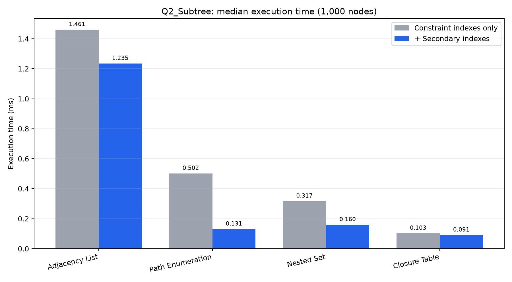
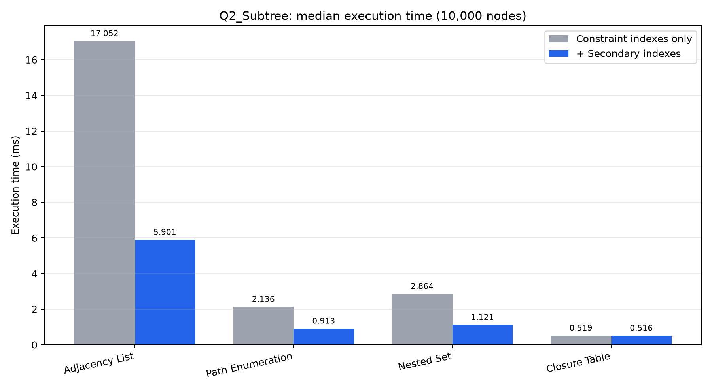
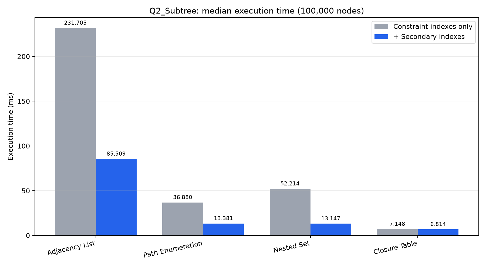
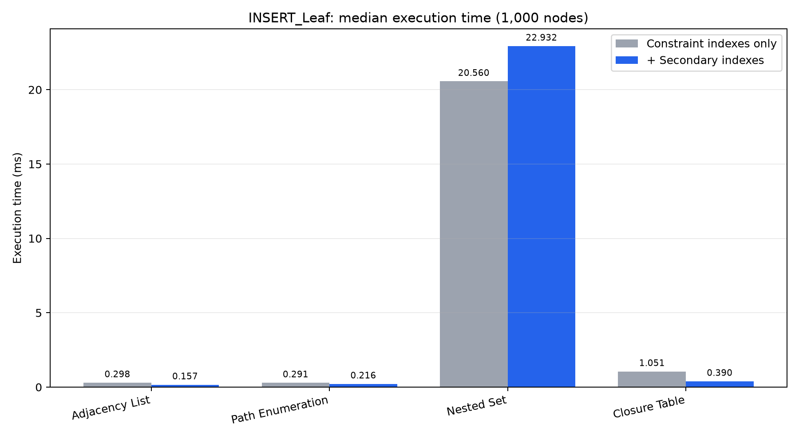
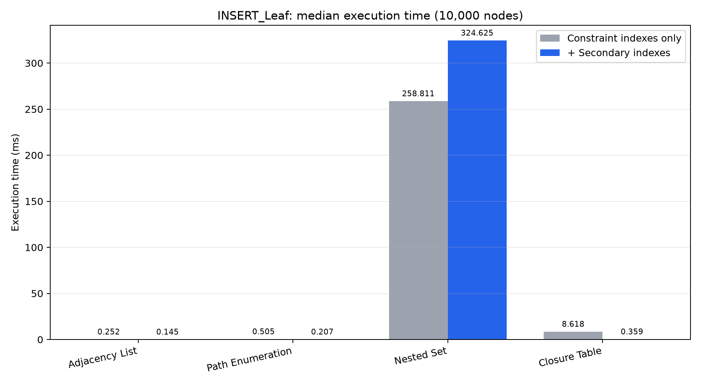
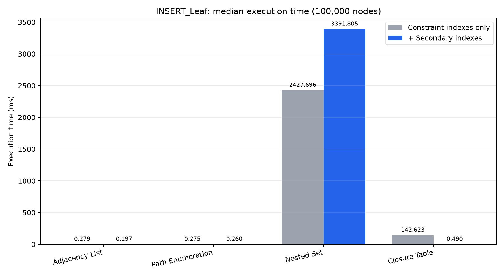
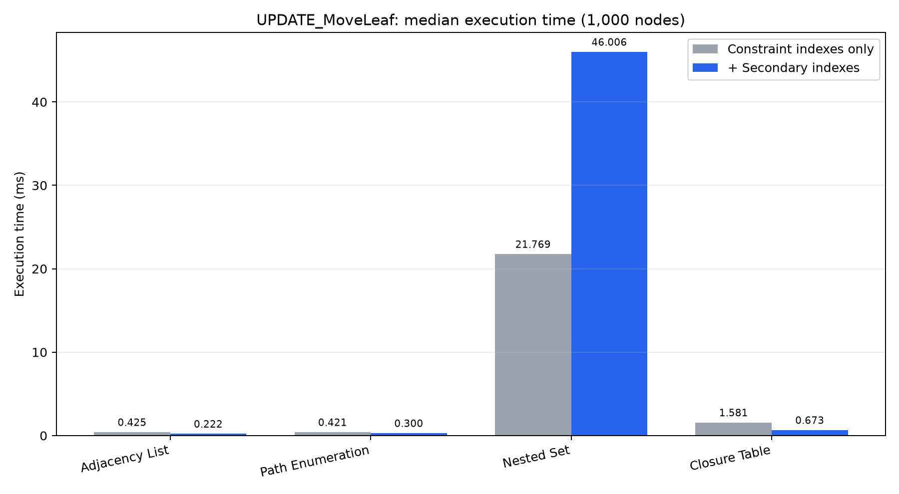
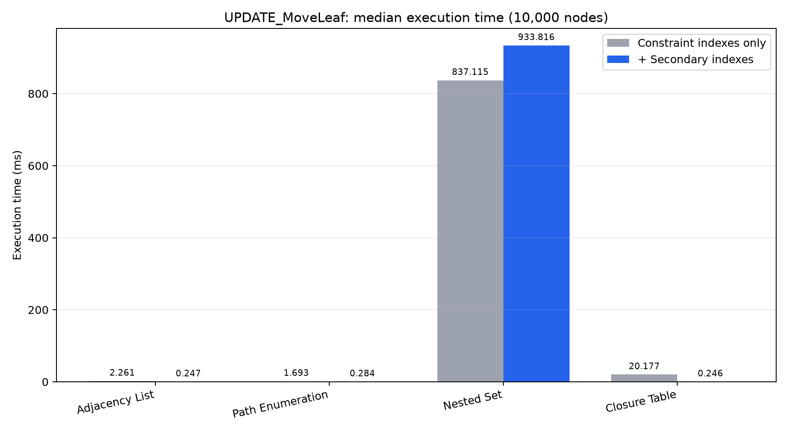
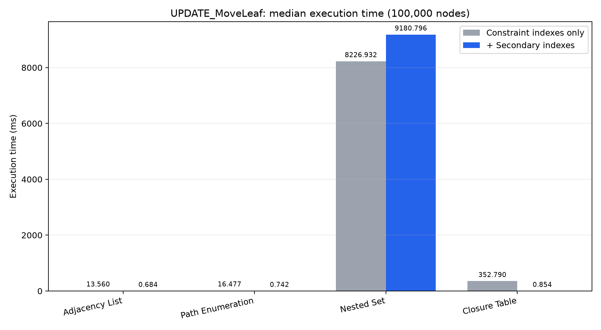

# CHƯƠNG 6. THỰC NGHIỆM, THIẾT KẾ VẬT LÝ VÀ ĐÁNH GIÁ HIỆU NĂNG

**Người phụ trách:** Quỳnh — TV5, Task 5.
**Đề tài 17:** Dữ liệu phân cấp và dữ liệu đồ thị trong CSDL quan hệ: ứng dụng mạng xã hội học tập.
**Ngày hoàn thiện:** 27/10/2026. **Run thực nghiệm:** `20261027T115624004654Z`.

## 6.1. Mục tiêu và phạm vi bàn giao

Chương trình bày phần dữ liệu kiểm chứng, kiểm tra phụ thuộc hàm, sinh dữ liệu lớn, thiết kế chỉ mục và benchmark PostgreSQL do Quỳnh phụ trách. Số chương theo `report/de_tai_17_report_outline.md`; phần thử tải đồng thời và Neo4j của TV4 không được gán thành kết quả do Quỳnh thực hiện.

Nguồn đối chiếu gồm `Phutrach.md`, `Phutrach.docx`, bốn tài liệu trong `kehoach_word/`, đặc tả `docs/spec.md`, danh sách FD của TV1, mã nguồn và bằng chứng thực nghiệm. Tài liệu kế hoạch gốc dùng TV1–TV5 chưa gắn tên; bảng phân công Markdown xác định TV5 là Quỳnh.

| Yêu cầu của Quỳnh | Đầu ra và bằng chứng | Kết quả |
| --- | --- | --- |
| Kiểm chứng FD của TV1 bằng SQL | `normalization/fd_check.sql`, `fd_*.txt`, `fd_regression.json` | Đạt; có kiểm thử dữ liệu sai |
| Dữ liệu cây 1k/10k/100k, bốn mô hình | `gen_tree_data.py`, `generated_data_manifest.json` | Đạt; đối chiếu từng dòng CSV |
| Dữ liệu graph 1k/5k, 10k/50k, 100k/500k | `gen_graph_data.py`, CSV PostgreSQL/Neo4j | Đạt; seed 42, không cạnh trùng/tự nối |
| Bổ sung cây ngẫu nhiên và chuỗi theo kế hoạch | `verify_tree_shapes.py`, `tree_shapes_manifest.json` | Đạt về dữ liệu; chưa đo thời gian các hình dạng này |
| Chỉ mục theo từng mô hình và graph | `benchmark/indexes.sql`, snapshot dung lượng/index | Đạt |
| Đo trước/sau chỉ mục, đọc và ghi | 360 dòng CSV, 72 plan JSON, 6 snapshot | Đạt |
| Bảng, biểu đồ, log, hỗ trợ slide | Summary, 9 PNG, nhật ký, `slides/task5_benchmark.md` | Đạt |
| Chạy lại PostgreSQL từ môi trường DB sạch | Cụm SCRAM riêng, schema/seed/SQL/cây/benchmark | Đạt trong môi trường Windows có sẵn phụ thuộc |
| Báo cáo chương Markdown và Word | Hai file `docs/bao_cao_chuong_6_Quynh.*` | Được sinh từ cùng nguồn số đo |

Không đồng nhất “cụm PostgreSQL sạch” với “máy mới chưa cài phần mềm”. Neo4j runtime, OQL/JPQL runtime và mọi cấu hình OS khác không thuộc lượt chạy lại này. Không dùng bảng hoàn thành thay chữ ký hay phê duyệt của thành viên.

## 6.2. Dữ liệu và kiểm chứng tính đúng

### 6.2.1. Hai lớp dữ liệu

Seed nhỏ `database/seed_test.sql` dùng đối chiếu kết quả tính tay. Dữ liệu lớn do `database/seed_bench.sql` sinh ở ba quy mô, nạp đồng bộ Adjacency List, Path Enumeration, Nested Set và Closure Table. Mọi truy vấn so sánh lấy cùng cây và node gốc; `validate_dataset.sql` kiểm tra cấu trúc và kết quả giữa các biểu diễn trước/sau đo.

| Số bình luận | Số dòng Path | Số dòng Nested Set | Số dòng Closure | Số cạnh friendship |
| ---: | ---: | ---: | ---: | ---: |
| 1.000 | 1.000 | 1.000 | 6.457 | 5.000 |
| 10.000 | 10.000 | 10.000 | 85.243 | 50.000 |
| 100.000 | 100.000 | 100.000 | 1.067.146 | 500.000 |

Số dòng Closure lớn hơn số node vì mỗi cặp tổ tiên–hậu duệ là một dòng, kể cả chính node với depth = 0. Bộ CSV Python tạo riêng để trao đổi/import, không được mặc định có cạnh graph giống hệt seed SQL: hai bộ có thuật toán sinh khác nhau. Các CSV graph dùng cặp có thứ tự user_a < user_b và định dạng import Neo4j tương ứng.

### 6.2.2. Tái lập và nhiều hình dạng cây

CSV cây mặc định là cây tam phân xác định; graph Python dùng bộ sinh `random.Random(42)`. `24` file CSV được kiểm tra nội dung và SHA-256 trong manifest. CSV lớn không đưa lên Git vì đã có script tái tạo; `.gitignore` loại `benchmark/data/*`.

Bổ sung `--shape random` và `--shape chain`; cây ngẫu nhiên dùng seed 42, cây chuỗi nối node i với i−1. Bộ kiểm chứng dựng lại đường đi, khoảng Nested Set và cặp Closure từ parent_id, rồi so sánh từng dòng; sinh lặp lại phải trùng từng byte.

| Hình dạng bổ sung | Số node | Độ sâu lớn nhất, root = 1 | Trạng thái |
| --- | ---: | ---: | --- |

| random | 1,000 | 14 | Đạt |
| random | 10,000 | 18 | Đạt |
| random | 100,000 | 25 | Đạt |
| chain | 1,000 | 1000 | Đạt |

Cây chuỗi giới hạn 1.000 node: Closure cần N(N+1)/2 dòng, tương ứng 500.500 dòng ở 1.000 node và 5.000.050.000 dòng ở 100.000 node. Giới hạn tránh sinh dữ liệu khổng lồ ngoài khả năng máy. Bộ bổ sung chỉ kiểm chứng dữ liệu, không được dùng để suy ra số đo hiệu năng cây chuỗi/ngẫu nhiên.

### 6.2.3. Kiểm chứng phụ thuộc hàm và quy tắc nghiệp vụ

`fd_check.sql` giữ các truy vấn chẩn đoán và thêm khối assertion cho đầy đủ f1–f5. So sánh `COUNT(DISTINCT to_jsonb(source))` theo thuộc tính xác định bao phủ toàn bộ thuộc tính phụ thuộc, không bỏ qua khác biệt NULL/non-NULL của parent_id như COUNT(DISTINCT parent_id) thông thường.

| FD của TV1 | Ánh xạ vật lý | Kiểm tra |
| --- | --- | --- |
| f1: comment_id → post_id, author_id, parent_id, content, created_at | `comment` | Toàn bộ dòng theo comment_id |
| f2: post_id → group_id | `post` | Toàn bộ dòng theo post_id, mạnh hơn f2 |
| f3: group_id → group_name, group_topic | `study_group.name`, `study_group.topic` | Toàn bộ dòng theo group_id |
| f4: author_id → author_name, author_email | `users.user_id`, `full_name`, `email` | Toàn bộ dòng theo user_id |
| f5: author_email → author_id, author_name | `users.email`, `user_id`, `full_name` | Toàn bộ dòng theo email |

Assertion BR2 kiểm user_a < user_b; BR6 kiểm cha/con cùng post_id; BR9 so bộ đếm bạn bè với graph hai chiều. Dữ liệu không hợp lệ phát sinh exception, làm `psql -v ON_ERROR_STOP=1` trả mã lỗi thay vì chỉ in bảng sai rồi tiếp tục. Kiểm BR9 tổng hợp cạnh theo user trước khi JOIN để tránh kế hoạch truy vấn chậm trên 100k user.

`validate_fd.py` dùng bản sao TEMP không có ràng buộc để cố ý tạo xung đột mà PK thật vốn đã chặn. Có 10 kiểm tra: seed hợp lệ, sửa parent_id/content/created_at, sửa group_id/topic/full_name, trùng email nhưng khác user_id, lệch friend_count và seed sau rollback. Mỗi mẫu sai phải bị từ chối; bảng thật không thay đổi. Kết quả ở `docs/review_evidence/2026-10-27/fd_regression.json`.

Kiểm tra hữu hạn không chứng minh FD đúng cho mọi trạng thái. Căn cứ FD vẫn là nghiệp vụ và ràng buộc schema. Phản ví dụ hai người trùng tên, khác email cho thấy không được suy diễn full_name → email chỉ vì seed nhỏ chưa có trùng tên.

## 6.3. Thiết kế vật lý và chỉ mục

| Mô hình | Chỉ mục bổ sung | Mục tiêu |
| --- | --- | --- |
| Adjacency List | B-tree `(post_id, parent_id)` | Tìm con trực tiếp trong CTE đệ quy |
| Path Enumeration | GiST `(path)` và B-tree `(post_id)` | Toán tử hậu duệ `<@` của ltree |
| Nested Set | B-tree `(post_id, lft, rgt)` | Lọc cùng bài và khoảng lft |
| Closure Table | B-tree `(ancestor, depth, descendant)`, `(descendant, ancestor)` | Truy xuất hậu duệ/tổ tiên |
| Friendship | B-tree `(user_b, user_a)` | Nhánh đảo chiều của view friend_edge |

Pha baseline chỉ bỏ chỉ mục phụ, vẫn giữ PK/UNIQUE và index bắt buộc của ràng buộc. Closure đã có PK `(ancestor, descendant)` nên baseline không phải “không có index”. Chỉ mục friendship được tạo và đo dung lượng nhưng workload thời gian của chương này là cây, không phải benchmark graph R1–R4 hay so sánh tốc độ Neo4j.

## 6.4. Môi trường và phương pháp thực nghiệm

| Thành phần | Giá trị |
| --- | --- |
| PostgreSQL | PostgreSQL 16.15, compiled by Visual C++ build 1944, 64-bit |
| OS | Windows-10-10.0.19045-SP0 |
| CPU | Intel64 Family 6 Model 142 Stepping 9, GenuineIntel; 4 CPU logic |
| RAM vật lý | 17,038,536,704 byte |
| Python | 3.15.0 |
| Run | `20261027T115624004654Z` |
| Số lần đo | 1 warm-up và 5 lần ghi nhận mỗi tổ hợp |
| Quy mô | 1.000, 10.000, 100.000 node |
| Chỉ mục | baseline giữ PK/UNIQUE; pha thêm index phụ |

Thông số DB chi tiết nằm trong `environment.json`: shared_buffers, work_mem, effective_cache_size, max_connections và jit. Máy làm việc thông thường, không cách ly toàn bộ tải OS; không suy rộng độ chính xác đến môi trường khác.

Ma trận gồm 3 quy mô × 4 mô hình × 2 pha chỉ mục × 3 workload × 5 lần = 360 số đo. Giá trị báo cáo là trung vị 5 lần. Mỗi phép đo dùng EXPLAIN (ANALYZE, BUFFERS, FORMAT JSON), lấy Execution Time, Planning Time, Shared Hit Blocks và Shared Read Blocks tại node gốc của plan, không cộng lặp buffer của các node con.

Ba workload: Q2_Subtree đếm cây con gồm node 2; INSERT_Leaf thêm lá dưới node 2; UPDATE_MoveLeaf chuyển lá N dưới node 2. Thao tác ghi gồm cập nhật dòng comment và metadata của đúng mô hình, chạy trong savepoint rồi rollback. Đây không phải độ trễ COMMIT hay throughput chuyển cả cây con lớn. Thứ tự đo đọc/dung lượng trước đo ghi tránh lẫn bảng bị phình do ghi vào snapshot ban đầu; rollback vẫn có thể để lại WAL, khoảng trống sequence và dead tuple vật lý.

## 6.5. Kết quả đo đọc và ghi

Mọi bảng sau trích trực tiếp CSV của run nêu trên; không ghép số đo 24/10/2026 với 27/10/2026. Tỉ số = thời gian baseline / thời gian thêm index; > 1 là nhanh hơn, < 1 là chậm hơn. Không thay số đo bằng số minh họa.

### 6.5.1. Đọc cây con
| Node | Mô hình | Baseline ms | Thêm index ms | Tỉ số |
| ---: | --- | ---: | ---: | ---: |
| 1,000 | Adjacency List | 1.461 | 1.235 | 1.18 |
| 1,000 | Path Enumeration | 0.502 | 0.131 | 3.83 |
| 1,000 | Nested Set | 0.317 | 0.160 | 1.98 |
| 1,000 | Closure Table | 0.103 | 0.091 | 1.13 |
| 10,000 | Adjacency List | 17.052 | 5.901 | 2.89 |
| 10,000 | Path Enumeration | 2.136 | 0.913 | 2.34 |
| 10,000 | Nested Set | 2.864 | 1.121 | 2.55 |
| 10,000 | Closure Table | 0.519 | 0.516 | 1.01 |
| 100,000 | Adjacency List | 231.705 | 85.509 | 2.71 |
| 100,000 | Path Enumeration | 36.880 | 13.381 | 2.76 |
| 100,000 | Nested Set | 52.214 | 13.147 | 3.97 |
| 100,000 | Closure Table | 7.148 | 6.814 | 1.05 |
### 6.5.2. Thêm lá
| Node | Mô hình | Baseline ms | Thêm index ms | Tỉ số |
| ---: | --- | ---: | ---: | ---: |
| 1,000 | Adjacency List | 0.298 | 0.157 | 1.90 |
| 1,000 | Path Enumeration | 0.291 | 0.216 | 1.35 |
| 1,000 | Nested Set | 20.560 | 22.932 | 0.90 |
| 1,000 | Closure Table | 1.051 | 0.390 | 2.69 |
| 10,000 | Adjacency List | 0.252 | 0.145 | 1.74 |
| 10,000 | Path Enumeration | 0.505 | 0.207 | 2.44 |
| 10,000 | Nested Set | 258.811 | 324.625 | 0.80 |
| 10,000 | Closure Table | 8.618 | 0.359 | 24.01 |
| 100,000 | Adjacency List | 0.279 | 0.197 | 1.42 |
| 100,000 | Path Enumeration | 0.275 | 0.260 | 1.06 |
| 100,000 | Nested Set | 2427.696 | 3391.805 | 0.72 |
| 100,000 | Closure Table | 142.623 | 0.490 | 291.07 |
### 6.5.3. Chuyển lá
| Node | Mô hình | Baseline ms | Thêm index ms | Tỉ số |
| ---: | --- | ---: | ---: | ---: |
| 1,000 | Adjacency List | 0.425 | 0.222 | 1.91 |
| 1,000 | Path Enumeration | 0.421 | 0.300 | 1.40 |
| 1,000 | Nested Set | 21.769 | 46.006 | 0.47 |
| 1,000 | Closure Table | 1.581 | 0.673 | 2.35 |
| 10,000 | Adjacency List | 2.261 | 0.247 | 9.15 |
| 10,000 | Path Enumeration | 1.693 | 0.284 | 5.96 |
| 10,000 | Nested Set | 837.115 | 933.816 | 0.90 |
| 10,000 | Closure Table | 20.177 | 0.246 | 82.02 |
| 100,000 | Adjacency List | 13.560 | 0.684 | 19.82 |
| 100,000 | Path Enumeration | 16.477 | 0.742 | 22.21 |
| 100,000 | Nested Set | 8226.932 | 9180.796 | 0.90 |
| 100,000 | Closure Table | 352.790 | 0.854 | 413.10 |
## 6.6. Planning time, buffer và dung lượng
### 6.6.1. Q2 tại 100.000 node, có chỉ mục phụ
| Mô hình | Planning ms | Execution ms | Shared hit | Shared read |
| --- | ---: | ---: | ---: | ---: |
| Adjacency List | 0.185 | 85.509 | 95810 | 0 |
| Path Enumeration | 0.130 | 13.381 | 1858 | 0 |
| Nested Set | 0.152 | 13.147 | 499 | 0 |
| Closure Table | 0.071 | 6.814 | 394 | 0 |
Shared hit là trang tìm thấy trong shared buffers; shared read là trang phải đọc vào shared buffers, không đồng nghĩa chắc chắn đọc đĩa vật lý vì còn cache OS. Không gọi phép đo này là cold-cache.
### 6.6.2. Dung lượng tại 100.000 node trước workload ghi
| Bảng | Heap byte | Index baseline byte | Index sau byte | Tổng sau byte |
| --- | ---: | ---: | ---: | ---: |
| comment | 7,659,520 | 2,260,992 | 3,915,776 | 11,608,064 |
| comment_closure | 47,259,648 | 38,289,408 | 95,961,088 | 143,253,504 |
| comment_ns | 4,431,872 | 3,047,424 | 6,225,920 | 10,682,368 |
| comment_path | 13,139,968 | 2,260,992 | 26,370,048 | 39,542,784 |
| friendship | 22,142,976 | 15,736,832 | 26,992,640 | 49,160,192 |

Heap đo bằng pg_relation_size; tổng index bằng pg_indexes_size; tổng quan hệ bằng pg_total_relation_size gồm lưu trữ phụ/TOAST. Snapshot nhỏ hơn và danh sách CREATE INDEX thực tế có trong raw JSON, bảng đầy đủ ở `benchmark/results/benchmark_summary.md`.

## 6.7. Phân tích kết quả và đánh đổi

Ở 100.000 node có chỉ mục phụ, mô hình đọc Q2 nhanh nhất trong lần đo là **Closure Table**, trung vị 6.814 ms. Mô hình INSERT chậm nhất là **Nested Set**; chuyển lá chậm nhất là **Nested Set**. Đây là nhận xét từ workload hiện tại, không phải định luật cho mọi cây hoặc mọi tỷ lệ đọc/ghi.

Adjacency List lưu gọn quan hệ cha/con và thuận tiện cập nhật liên kết; đọc hậu duệ phải đệ quy. ltree biểu diễn đường đi, khai thác GiST nhưng chuyển cây con lớn phải cập nhật nhiều đường dẫn. Nested Set hỗ trợ đọc theo khoảng; thêm/chuyển node có thể dịch nhiều mốc lft/rgt nên index không loại bỏ chi phí ghi hàng loạt. Closure Table tăng số dòng và dung lượng index để đổi lấy tra cứu quan hệ tổ tiên–hậu duệ trực tiếp; việc chuyển một lá không đại diện chi phí chuyển subtree lớn.

Chọn mô hình phải dựa trên tỷ lệ đọc/ghi, hình dạng cây và ngân sách dung lượng. Không kết luận index luôn tăng tốc; xem cả tổ hợp có tỉ số dưới 1. Không so tốc độ PostgreSQL/Neo4j bằng bộ số khác workload, cấu hình hay thời điểm.

## 6.8. Quy trình tái lập từ đầu

Các lệnh chạy tại thư mục gốc repo trên Windows có PostgreSQL 16 và Python. Runner tạo cụm riêng chỉ lắng nghe loopback, dùng SCRAM và mật khẩu ngẫu nhiên; không cần mật khẩu DB đang dùng. Cụm dừng và dọn khi hoàn tất. Không chạy seed_bench.sql vào DB chứa dữ liệu cần giữ: script này TRUNCATE dữ liệu ứng dụng.

```powershell
python -m pip install -r benchmark/requirements.txt
python -m pip install -r docs/scripts/requirements.txt
python benchmark/scripts/run_complete.py --postgres-bin "C:/Program Files/PostgreSQL/16/bin"
python benchmark/scripts/gen_tree_data.py --sizes 1000 10000 100000
python benchmark/scripts/gen_graph_data.py --all
python benchmark/scripts/verify_generated_data.py
python benchmark/scripts/verify_tree_shapes.py
```

Runner in đường dẫn run hoàn tất. Dùng đúng đường dẫn mới thay tham số dưới đây; không mặc định run mới trùng ID trong báo cáo.

```powershell
python benchmark/scripts/publish_results.py --run-dir benchmark/results/runs/20261027T115624004654Z
python docs/scripts/build_quynh_report.py
python docs/scripts/export_markdown_docx.py docs/bao_cao_chuong_6_Quynh.md docs/bao_cao_chuong_6_Quynh.docx
```

Script build tạo cả Markdown lẫn Word; lệnh export riêng dùng khi chỉnh nội dung Markdown rồi cần xuất lại. DOCX có tiêu đề, bảng thật, số trang và biểu đồ nhúng, không phải đổi đuôi tệp. Log regression ngày 27/10 được giữ làm bằng chứng lịch sử, không tự đổi thành kết quả của một lần chạy tương lai.

## 6.9. Rà soát tích hợp và giới hạn nghiệm thu

Lượt rà bao gồm cây thư mục mã nguồn, phân công và kế hoạch; kiểm cú pháp Python/PowerShell; chạy schema, constraints, seed, SQL nâng cao Q1–Q12, truy vấn recursive, 4NF, T1 trên cụm mới; runner chạy CRUD/Q1–Q10 của bốn mô hình và kiểm cấu trúc sau mỗi nhóm. Danh mục mã nguồn và log ở `docs/review_evidence/2026-10-27/`; không coi inventory là chứng minh đã kiểm thử mọi nhánh của mọi chương trình.

Đã bổ sung: assertion FD bao phủ đủ thuộc tính và NULL, kiểm thử âm tự rollback, ba hình dạng cây và tái lập byte, báo cáo chương riêng, xuất Word có kiểm tra cấu trúc. Một lần chạy đầu bị dừng vì truy vấn kiểm BR9 bổ sung chọn kế hoạch chậm ở 100k; đã sửa bằng tổng hợp trước JOIN và chạy lại đầy đủ. Run dở không dùng để thống kê.

Giới hạn còn lại thuộc phạm vi nghiên cứu/chung: chưa benchmark cây ngẫu nhiên/chuỗi, cold-cache, chuyển subtree lớn, graph R1–R4 trên ba cỡ trong cùng ma trận, so DB quan hệ với Neo4j trong cùng điều kiện. Không tự xác nhận ảnh Neo4j hay OQL/JPQL runtime. Phần báo cáo/slide chung và chữ ký do người phụ trách xác nhận; tham khảo `docs/task_review_2026-10-24.md`.

## 6.10. Kết luận

Phần Quỳnh theo phân công cụ thể đã có dữ liệu, code tái lập, kiểm chứng đúng/sai, thiết kế chỉ mục, đủ 360 số đo đọc/ghi, số đo buffer/dung lượng, 9 biểu đồ và báo cáo hai định dạng. Kế hoạch mở rộng hình dạng cây đã được bổ sung ở mức sinh/kiểm chứng dữ liệu; không gán hiệu năng chưa đo. Kết luận lựa chọn mô hình gắn với workload và giới hạn đã nêu, không tuyên bố toàn bộ đồ án đạt 100%.

## Phụ lục A. Biểu đồ thực nghiệm











## Phụ lục B. Nguồn và minh chứng nội bộ

- Phân công: `Phutrach.md`; kế hoạch: `kehoach_word/01_...docx` đến `04_...docx`.
- Cơ sở FD: `normalization/fd_list.md`; schema và seed: `database/`.
- Chỉ mục và workloads: `benchmark/indexes.sql`, `benchmark/write_workloads.sql`.
- Run gốc: `benchmark/results/runs/20261027T115624004654Z`; completion, environment, CSV và artifacts đi cùng run.
- Corpus: `benchmark/results/generated_data_manifest.json`, `benchmark/results/tree_shapes_manifest.json`.
- Kiểm thử bổ sung: `docs/review_evidence/2026-10-27/`.
- Nhật ký và slide: `docs/experiment_log/task5_completed.md`, `slides/task5_benchmark.md`.
- Báo cáo số đo đầy đủ: `report/task5_benchmark_results.md`, `benchmark/results/benchmark_summary.md`.
